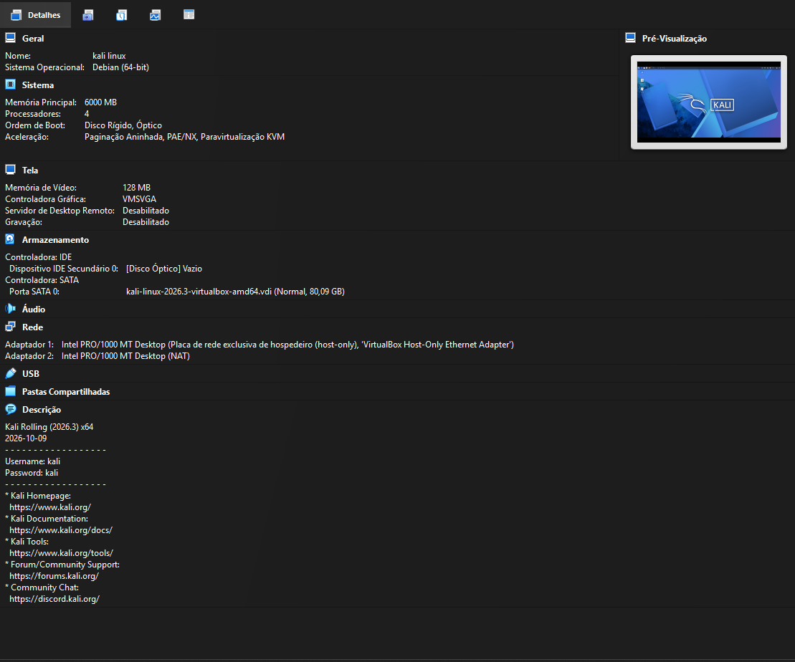
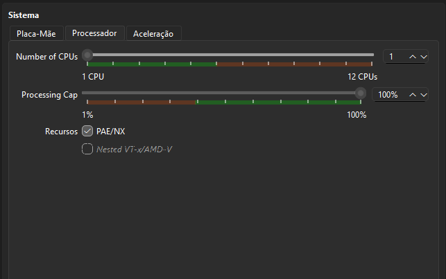
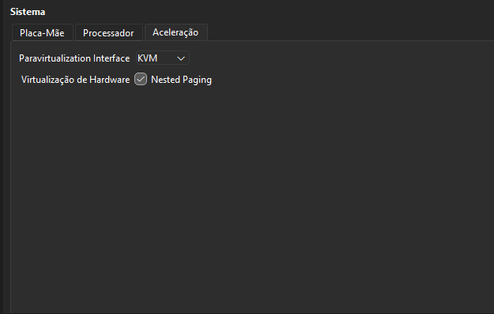

# Criação do Ambiente Virtual

## Objetivo

Preparar um ambiente virtual isolado e controlado para a realização 
dos testes de segurança envolvendo os serviços FTP, DVWA e SMB.

O laboratório utiliza máquinas virtuais, incluindo o Kali Linux e 
o Metasploitable, um sistema intencionalmente vulnerável, permitindo 
a observação e análise de possíveis vulnerabilidades em um ambiente 
controlado.

Nesta etapa, serão apresentadas as configurações das máquinas virtuais 
e da rede utilizadas durante os testes.

## Ferramentas

Foram utilizadas as seguintes ferramentas:

- VirtualBox: software de virtualização utilizado para executar e gerenciar as máquinas virtuais.
- Kali Linux: distribuição Linux utilizada para executar as ferramentas de análise e auditoria de segurança.
- Metasploitable 2: máquina virtual intencionalmente vulnerável, utilizada como alvo dos testes.

### Kali Linux

O Kali Linux foi utilizado como máquina de auditoria, responsável pela execução das ferramentas Medusa para simular cenários de ataque de força bruta a fim de realizar testes de segurança.

**Configurações da máquina virtual:**

- Distribuição: Kali Linux Rolling 2026.3 x64
- Memória RAM: 6000 MB
- Processadores: 4
- Memória de vídeo: 128 MB
- Armazenamento: 80,09 GB
- Adaptador de rede 1: Host-Only
- Adaptador de rede 2: NAT

### Metasploitable 2

O Metasploitable 2 foi utilizado como a máquina-alvo dos ataques, uma vez que essa e uma maquina intencionalmente vulnerável.

**Configurações da máquina virtual:**

- Sistema operacional: Ubuntu (64-bit), conforme configuração do VirtualBox
- Memória RAM: 4000 MB
- Memória de vídeo: 16 MB
- Armazenamento: 8 GB
- Adaptador de rede: Host-Only
- Metasploitable 2 (Host-Only): `192.168.56.101`
- Kernel: Linux 2.6.24-16-server
- Arquitetura: i686 (32 bits)
- Processadores: 1

**Observações de configuração:**

Para garantir o funcionamento adequado da máquina virtual, foram utilizadas as seguintes configurações adicionais:

- Número de CPUs: 1
- PAE/NX: Habilitado
- Interface de paravirtualização: KVM
- Paginação aninhada (Nested Paging): Habilitada

