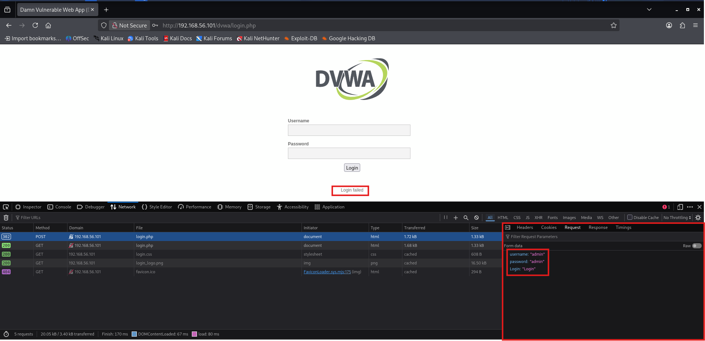
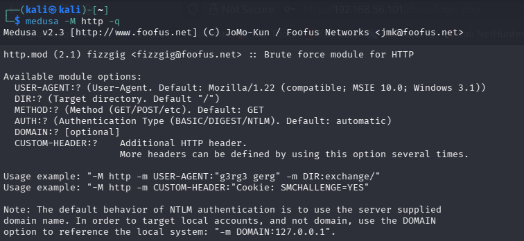
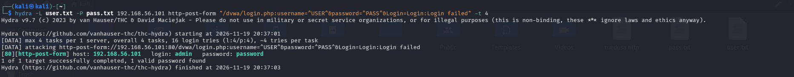
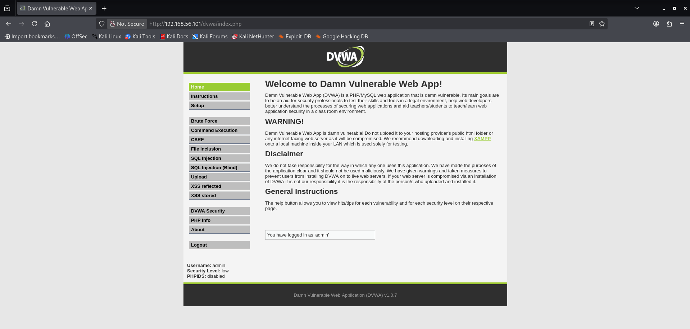

# Automação de tentativas de autenticação em formulário web (DVWA)

## 1. Objetivo

Avaliar a vulnerabilidade de um formulário de autenticação web a tentativas automatizadas de força bruta, utilizando o Medusa e o Hydra em um ambiente de laboratório controlado com o Metasploitable 2.

O teste busca demonstrar como senhas fracas e a ausência de mecanismos adequados de proteção podem facilitar a descoberta de credenciais e permitir o acesso não autorizado a uma aplicação web.

## 2. Ferramentas utilizadas

Foram utilizadas as seguintes ferramentas:

- **VirtualBox:** software de virtualização utilizado para executar e gerenciar as máquinas virtuais.
- **Kali Linux:** distribuição Linux utilizada para executar ferramentas de análise e auditoria de segurança.
- **Metasploitable 2:** máquina virtual intencionalmente vulnerável, utilizada como ambiente de testes.
- **Medusa:** ferramenta utilizada para realizar testes automatizados de autenticação.
- **Hydra:** ferramenta utilizada como alternativa para testar autenticações em formulários HTTP.
- **DVWA (Damn Vulnerable Web Application):** aplicação web desenvolvida em PHP e MySQL, intencionalmente vulnerável, que permite estudar falhas comuns de segurança em aplicações web. Possui diferentes níveis de dificuldade para os testes.

## 3. Procedimentos

Todos os procedimentos foram executados pelo terminal e pelo navegador Firefox do Kali Linux, enquanto as máquinas virtuais estavam em funcionamento e conectadas à rede Host-Only.

### 3.1. Coleta de informações do formulário web

Inicialmente, foi acessado o formulário de autenticação do DVWA pelo navegador, utilizando o endereço:

`http://192.168.56.101/dvwa/login.php`

Foi realizada uma tentativa de autenticação com credenciais incorretas. Em seguida, por meio das ferramentas de desenvolvedor do Firefox, na aba Network (Rede), foram analisadas as informações da requisição HTTP do tipo POST.



Essa etapa permitiu observar os parâmetros utilizados pela aplicação durante a autenticação, informações importantes para compreender o funcionamento do formulário e avaliar a compatibilidade das ferramentas de auditoria.

### 3.2. Criação das wordlists

Em seguida, foram criadas duas listas de teste, uma contendo possíveis nomes de usuários e outra contendo possíveis senhas.

Os comandos utilizados foram:

```bash
echo -e "user\nmsfadmin\nadmin\nroot" > users.txt
```

```bash
echo -e "123456\npassword\nqwertyI\nmsfadmin" > pass.txt
```

As listas foram utilizadas como base para as tentativas automatizadas de autenticação.

### 3.3. Tentativa de utilização do Medusa

Inicialmente, foi tentada a utilização do módulo HTTP do Medusa para realizar a auditoria do formulário.

O comando utilizado foi:

```bash
medusa -h 192.168.56.101 -U users.txt -P pass.txt -M http \
-m PAGE:'/dvwa/login.php' \
-m FORM:'username=^USER^&password=^PASS^&Login=Login' \
-m 'FAIL-Login failed' -t 6
```

Entretanto, durante os testes, não foi possível obter o resultado esperado, mesmo após algumas modificações no comando e verificações das configurações da máquina virtual.

Após investigar as opções disponíveis no módulo `http.mod` (versão 2.1), foi identificada uma limitação relacionada ao suporte necessário para configurar e validar adequadamente as requisições do formulário utilizado no experimento.

A documentação exibida pelo próprio módulo indicava que os parâmetros necessários para esse cenário não estavam disponíveis da maneira esperada.



Diante dessa limitação, foi escolhida outra ferramenta para dar continuidade ao teste.

### 3.4. Execução do teste com Hydra

Como alternativa, foi utilizado o Hydra, que possui suporte específico a formulários HTTP enviados por requisições POST.

Com base nas informações coletadas anteriormente, foram considerados os seguintes parâmetros:

- Campo de usuário: `username`
- Campo de senha: `password`
- Campo de envio: `Login`
- Mensagem de falha observada: `Login failed`

O comando utilizado foi:

```bash 
hydra -L users.txt -P pass.txt 192.168.56.101 http-post-form "/dvwa/login.php:username=^USER^&password=^PASS^&Login=Login:Login failed" -t 4
```

Nesse comando:

- `-L`: informa a lista de possíveis usuários.
- `-P`: informa a lista de possíveis senhas.
- `http-post-form`: seleciona o módulo de autenticação por formulário HTTP POST.
- `/dvwa/login.php`: caminho do formulário utilizado.
- `^USER^` e `^PASS^`: marcadores substituídos pelas combinações das wordlists.
- `Login failed`: texto utilizado para identificar uma resposta de falha na autenticação.
- `-t 4`: define quatro tarefas simultâneas.

A execução apresentou um resultado positivo, identificando uma combinação de credenciais aceita pelo formulário.



### 3.5. Validação do acesso ao DVWA

Por fim, foi realizada uma nova tentativa de autenticação diretamente pelo navegador, utilizando as credenciais identificadas pelo Hydra:

- Usuário: `admin`
- Senha: `password`

A autenticação foi aceita, confirmando o resultado obtido na etapa anterior.



## 4. Resultados e análise

O teste demonstrou que foi possível identificar uma combinação de usuário e senha aceita pelo formulário web utilizando uma wordlist pequena.

O resultado reforça que senhas fracas, previsíveis ou reutilizadas representam um risco significativo, principalmente em aplicações que não possuem mecanismos adequados de proteção contra tentativas repetidas de autenticação.

Também foi possível observar que diferentes ferramentas podem apresentar limitações dependendo do serviço e do método de autenticação utilizado. Nesse caso, a dificuldade encontrada com o módulo HTTP do Medusa levou à investigação de suas opções e à escolha do Hydra como alternativa.

O DVWA estava configurado no nível de segurança *Low*, o que tornou possível demonstrar a vulnerabilidade em um ambiente controlado. Esse resultado não significa que todas as aplicações web apresentem o mesmo comportamento.

## 5. Medidas de segurança e mitigação

Para reduzir os riscos identificados, algumas medidas de segurança são recomendadas:

- Utilizar senhas fortes, exclusivas e difíceis de prever.
- Implementar limitação de tentativas de autenticação e mecanismos de bloqueio temporário.
- Adotar autenticação multifator (MFA), sempre que possível.
- Monitorar registros de autenticação para identificar atividades suspeitas.
- Implementar mecanismos de CAPTCHA como uma camada adicional de proteção, sem depender exclusivamente deles.
- Proteger as sessões e os dados de autenticação, utilizando HTTPS.
- Armazenar senhas de forma segura no servidor, utilizando algoritmos apropriados de hash com salt.
- Realizar testes periódicos de segurança nas aplicações web.

## 6. Conclusão

Ao final dos testes, foi possível demonstrar como senhas fracas e a ausência de mecanismos adequados de proteção podem comprometer a segurança de um formulário de autenticação web.

Além disso, a experiência evidenciou a importância de compreender as ferramentas utilizadas, investigar suas limitações e buscar alternativas quando necessário.

O experimento reforça que a segurança de uma aplicação não depende apenas da escolha de senhas adequadas, mas também da implementação de mecanismos eficientes de proteção, monitoramento e controle de acesso.